# Build Log: November 14–15, 2026

**Goal for the weekend:** Wire the house to the rack, bring up VLAN 10 (Home) and VLAN 20 (Gaming), and plan the move out of the living room.

**End result:** Cat6 runs land on a patch panel, and VLANs 10 and 20 are routed on the ISR with DHCP pools. I also tracked down two speed problems. A loose coax connection took the whole house down to 13 Mbps (fixed: 403 Mbps after reseating), and the new wall run only negotiates at 100 Mbps (still open).

---

## Starting point

| Device | State at the start of the weekend |
|--------|----------------------|
| ISR 4331 | G0/0/0 = 192.168.0.191 (DHCP reservation), G0/0/1 trunk to SW1 with G0/0/1.40 (Servers) plus the ACL test subinterfaces .50/.60 |
| Catalyst 3560X (SW1) | Gi0/47 trunk to the ISR, Gi0/1 = Proxmox (trunk, native VLAN 40) |
| Home network | TP-Link Archer AXE75 (192.168.0.1), Xfinity XB7 in bridge mode, 1 Gbps plan |
| DNS | TP-Link hands out Pi-hole (10.10.40.30) as primary DNS and 1.1.1.1 as secondary |

---


## Step 1: Physical work

* Ran Cat6 through the house and terminated the runs on a patch panel in the server rack.
* **Garage move plan:** New coax needed. Cut a coax that was connected to a old satellite dish. Had to remove the grounding wire but was able to create a new coax cable to connect to the modem with this. I simply removed the active line that runs to the house and swapped it with the new coax line running to the garage.
* **Rack power:** picked the CyberPower **CPS1215RMS** (1U, 12 outlets, 1800 J, 400V clamp, 15 ft cord).
  * Skipped the CPS1215RM. Its only surge spec is an 800V clamp, so it's basically a power strip.
  * Skipped the Tecmojo 8-outlet. No published joule or clamping rating.
  * The Tripp Lite DRS-1215 (UL 1449 Listed, 330V, 3000 J) was the premium option. Tripp Lite voids the surge warranty if it's plugged into a UPS.
* **Mounting:** cage nuts and M6 screws for square-hole rails. Use the insertion tool.

---

## Step 3: VLAN 10 test port on the switch

```
interface GigabitEthernet0/13
 description FRP1-SW1-PATCHPANEL
 switchport mode access
 switchport access vlan 10
 spanning-tree portfast
 no shutdown
```

For the first test, I gave the PC a static IP (10.10.10.50/24, gateway 10.10.10.1) instead of using DHCP. Because Proxmox was down, I set DNS to 1.1.1.1 instead of the Pi-hole.

---

## Step 4: VLAN 10 and 20 subinterfaces on the ISR

```
interface GigabitEthernet0/0/1.10
 description VLAN10 Home Network
 encapsulation dot1Q 10
 ip address 10.10.10.1 255.255.255.0
 ip nat inside
 no shutdown
interface GigabitEthernet0/0/1.20
 description VLAN20-Gaming
 encapsulation dot1Q 20
 ip address 10.10.20.1 255.255.255.0
 ip nat inside
 no shutdown
```

* Subinterfaces can't share an `interface range` command, since each needs its own tag and IP, but both blocks paste in one session. No `exit` is needed between them.
* **NAT:** no ACL change needed. `NAT-LAB` already uses a /16 (`deny 10.10.0.0/16 → 192.168.0.0/24`, `permit 10.10.0.0/16 → any`), so every new VLAN is covered. Each new subinterface only needs `ip nat inside`.

**Switch side for VLAN 20:**
```
vlan 20
 name Gaming
interface Gi0/47
 switchport trunk allowed vlan add 20
```
`add` matters here. Without it, the command replaces the whole allowed list. VLAN 10 needs the same `add` if the trunk has a restricted list.

**Verify:** `show interfaces` showed G0/0/1.10, .20 and .40 all up/up with the right VLAN IDs and IPs.

---

## Step 5: DHCP pools on the ISR

```
ip dhcp excluded-address 10.10.10.1 10.10.10.20
ip dhcp excluded-address 10.10.20.1 10.10.20.20

ip dhcp pool VLAN10-HOME
 network 10.10.10.0 255.255.255.0
 default-router 10.10.10.1
 dns-server 10.10.40.30 1.1.1.1
 lease 1

ip dhcp pool VLAN20-GAMING
 network 10.10.20.0 255.255.255.0
 default-router 10.10.20.1
 dns-server 10.10.40.30 1.1.1.1
 lease 1
```

* Set the exclusions before the pools so the router never leases an address reserved for static devices.
* The router matches each pool to its subinterface by the `network` statement, not by the pool name.
* VLAN 40 never needed a pool because everything there (Proxmox, Pi-hole, Jellyfin) has a static IP.

Two "default" settings that are easy to mix up:
* `default-router` in a pool is the **client's** gateway, which is the subinterface IP (facing down the trunk).
* The **ISR's** own default route points up to the TP-Link (192.168.0.1) through G0/0/0. It's learned through DHCP, so it shows as `S*` with no `ip route` line in the config.

**Verify:** `show ip dhcp pool`, `show ip dhcp binding`, `show ip dhcp conflict`

---

## Step 6: ISR throughput level

The ISR4331 ships with throughput capped at **100 Mbps**. I raised it:
```
platform hardware throughput level boost
```
The boost license removes the cap entirely, so the 1 Gbps ports and my 1 Gig plan become the limit.

---

## Problem: Steam downloads crawling

| # | Test / action | Result | What it told me |
|---|---------------|--------|-----------------|
| 1 | Steam over Wi-Fi | 117 Mbps | Slow even without the lab in the path |
| 2 | Speedtest over Wi-Fi with Steam still running | 13 Mbps, 411 ms **idle** ping | Steam saturating the line (bufferbloat), so not a clean test |
| 3 | ISR subinterface counters | txload 8/255 | ISR not overloaded. `BW 1000000` is just a nominal value, not a speed |
| 4 | TP-Link system log | WAN lease renewing cleanly, no drops. QoS and Parental Controls on | Comcast link stable. QoS is a possible limiter |
| 5 | XB7 signal page (temporarily out of bridge mode) | DS SNR 43.8–45.1 dB, power 5.8–6.6 dBmV, OFDM ch 193 locked. US 38.0–38.5 dBmV | Coax signal healthy |
| 6 | Restarted the XB7 and TP-Link, **reseated the coax** | **403 down / 42 up**, 11 ms idle, 116 ms loaded | Fixed the house-wide problem. Bufferbloat remains |
| 7 | Speedtest wired through the lab (VLAN 10) | 95 down / 42 up | 94–95 Mbps means a 100 Mb link |
| 8 | `Get-NetAdapter` / `Get-NetRoute` on the PC | Ethernet 3 = wall run, next hop 10.10.10.1, **100 Mbps**. Equal route metrics with Wi-Fi | Windows prefers wired, so all traffic took the slow link |
| 9 | `show interfaces Gi0/13 status` | a-full, **a-100** | Switch confirms 100 Mb negotiation |
| 10 | TDR on Gi0/13 | N/A on all pairs | Inconclusive. Read too soon, and TDR doesn't like a live 100M link |
| 11 | Handheld cable tester | Clean | Continuity is fine. Still possible: split pairs or the PC adapter |

**Notes:**
* To see signal levels, I had to check 10.0.0.1 → Gateway → Connection → Xfinity Network.
* The TP-Link log's June 3 timestamps are its firmware build date, used until the clock syncs, not the real reboot time.

---

## Lessons learned

1. **94–95 Mbps on a gigabit plan = something linked at 100 Mb.** 100BASE-TX only uses pairs 1-2 and 3-6, so a bad blue or brown pair still "works."
2. **Never speed-test during a big download.** The result measures the leftovers.
3. **With two default routes at equal metric, Windows picks wired, even when it's slower.** Use `Set-NetIPInterface -InterfaceMetric` to control it.
4. **Check the physical layer early.** A loose coax connector looked fine on the signal page and still cut speeds to a crawl.

---

## Commands I relied on this weekend

| Command | What it told me |
|---------|-----------------|
| `show interfaces Gi0/13 status` | Negotiated speed/duplex (caught a-100) |
| `test cable-diagnostics tdr interface` / `show cable-diagnostics tdr` | Per-pair cable faults (best run with the far end unplugged) |
| `show interfaces trunk` | Allowed VLANs on Gi0/47 |
| `show run \| section access-list` | Confirmed NAT-LAB already covers 10.10.0.0/16 |
| `show ip dhcp binding` / `show ip dhcp pool` | Lease activity |
| `show platform hardware throughput level` | ISR throughput cap |
| `Get-NetAdapter \| Select Name, Status, LinkSpeed` | PC link speeds per adapter |
| `Get-NetRoute -DestinationPrefix 0.0.0.0/0` | Which adapter Windows uses for internet |

---

## Next steps

- [ ] Run the PS5 connection test and record the NAT type (double NAT likely gives Type 3)
- [ ] NTP on the switch and ISR (the switch clock reads March 2)
- [ ] Buy the CPS1215RMS and cage nuts. Consider a small UPS with NUT for clean Proxmox shutdowns
- [ ] Check whether the 3560X is a PoE model (-P/-PF) for the EAP610. If not, the Catalyst 2960-CX-8PC-L is the top pick
- [ ] Build OPNsense on the second OptiPlex as the lab edge: gigabit routing and SQM (fq_codel/CAKE) for bufferbloat
- [ ] Long term: a second Pi-hole outside the lab path to replace the 1.1.1.1 secondary

---

## Screenshots

My public IP is blurred out in the speed tests.

**Night of Nov 14: the setup when it was working**

| | |
|---|---|
| 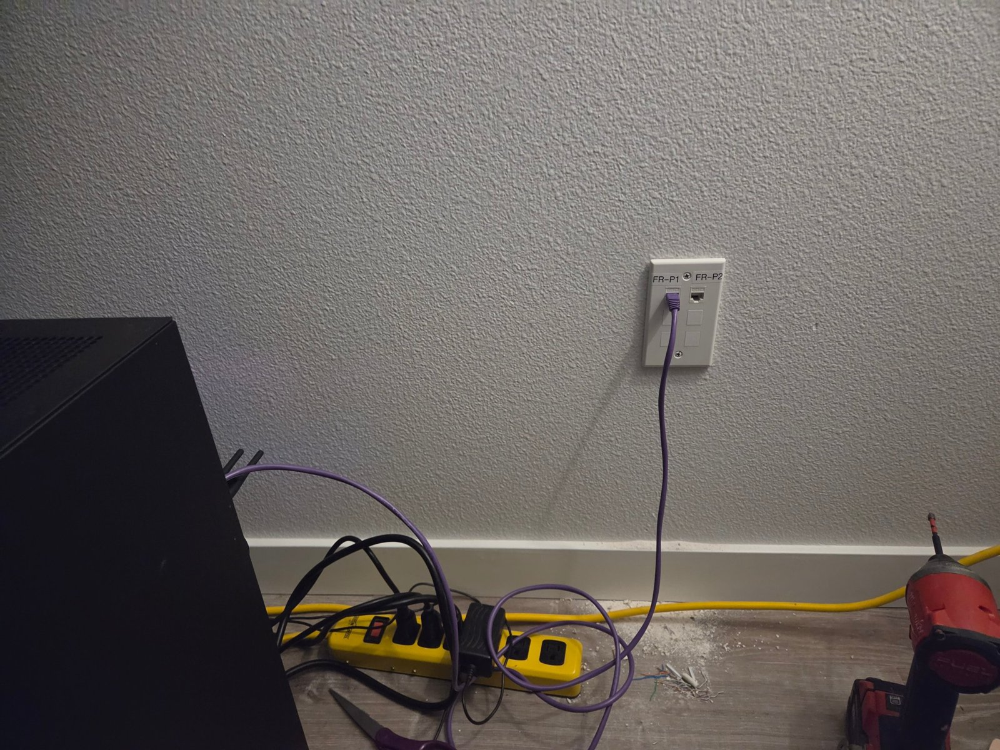 | 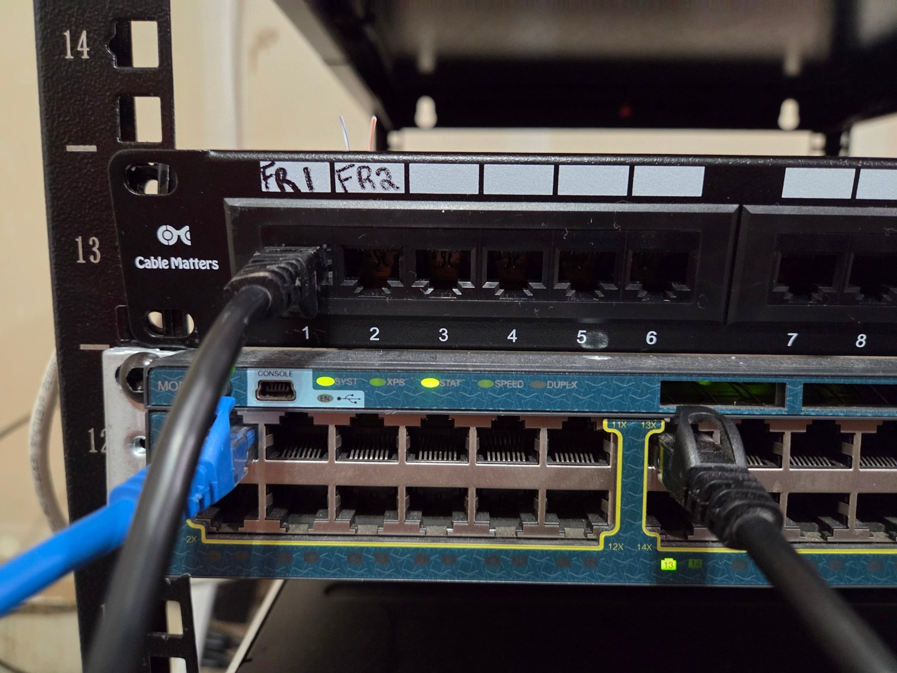 |
| Wall plate: FR-P1 in use, FR-P2 spare | Patch panel port 1 (FR1) to Gi0/13 |

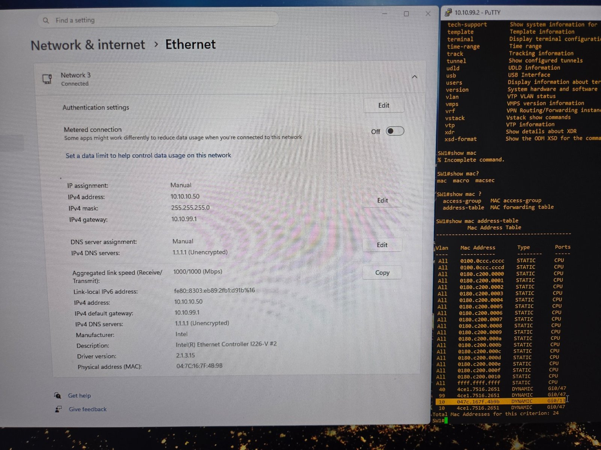

The adapter linked at 1000/1000 on FR1, and the PC's MAC shows on Gi0/13 in VLAN 10. The gateway is set to **10.10.99.1**, which is wrong I made a mistake here: it's outside the PC's 10.10.10.0/24 subnet, so this connection had no working internet route. I wasn't thinking about what subnet my PC belonged to when I configured this static route and just mistakenly added the management IP for my ISR. I was even more confused when everything still worked after running some speed test.

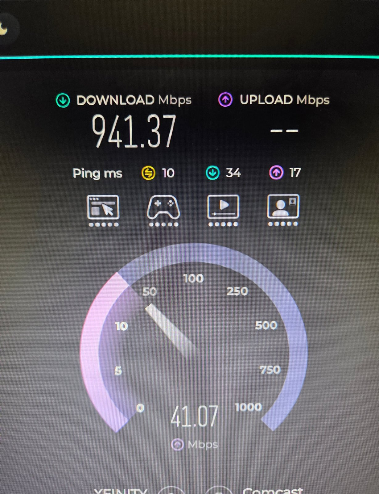

The gateway was misconfigured as 10.10.99.1, but proxy ARP on the ISR let it work anyway, and the 941 test went through the lab.

**Nov 15: troubleshooting**

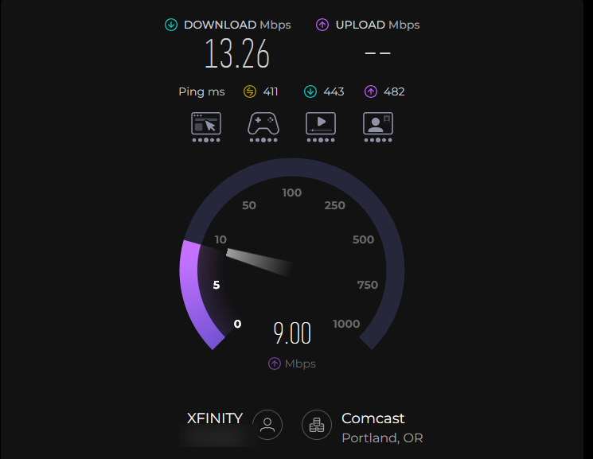

Speed test with Steam still downloading: 13 Mbps and a 411 ms idle ping. The line was saturated.

| | |
|---|---|
| 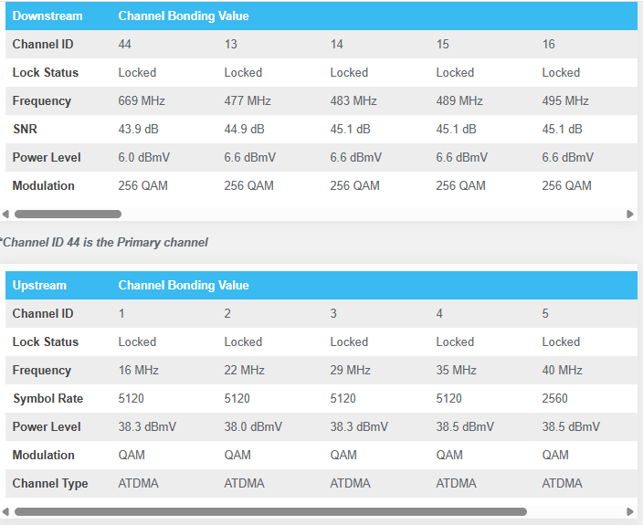 | 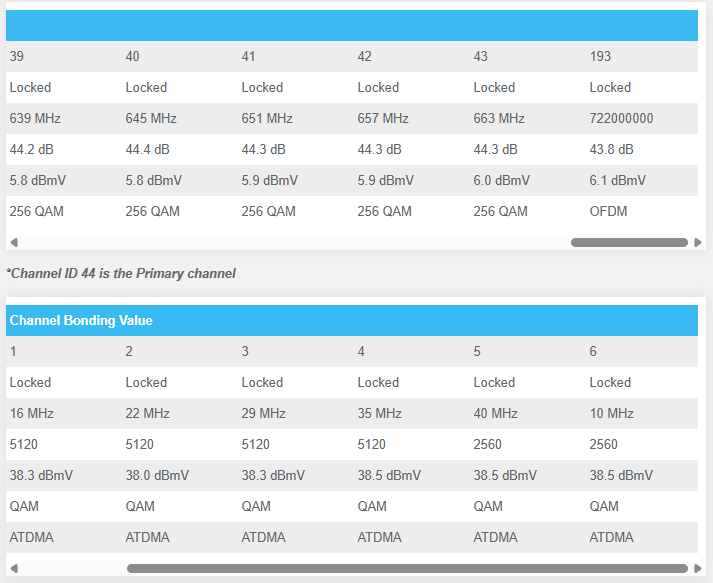 |
| XB7 signal: SNR ~44–45 dB, power ~6 dBmV | OFDM channel 193 locked, upstream ~38 dBmV |

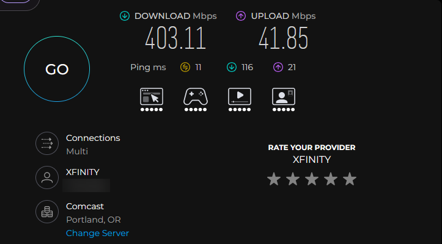

After restarting the XB7 and TP-Link and reseating the coax: 403 Mbps over Wi-Fi.

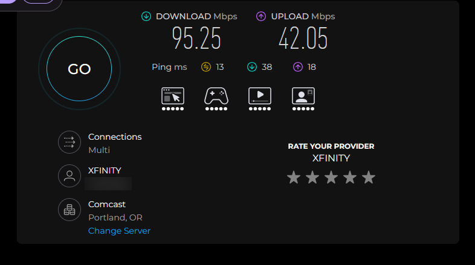

95 Mbps through the FR1 run, which is the ceiling of a 100 Mb link.

| | |
|---|---|
| 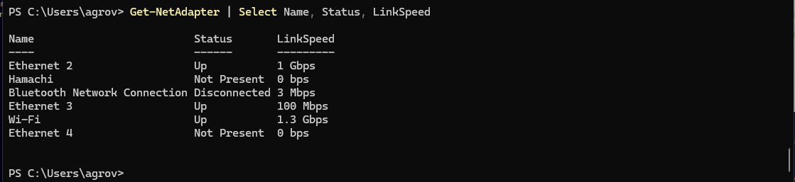 | 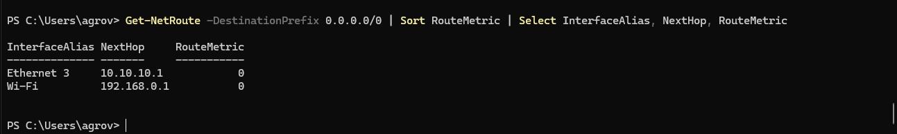 |
| Ethernet 3 (FR1) linked at 100 Mbps | Two default routes at equal metric. Wired wins |

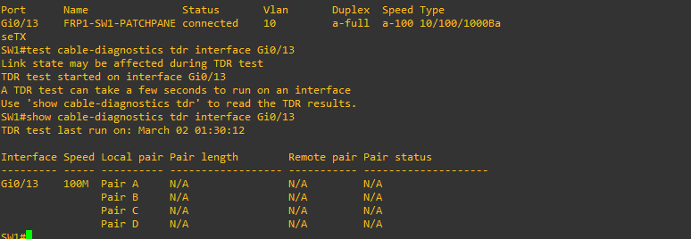

Gi0/13 negotiated a-100. The TDR returned N/A with the link up.

**The fix: moved to FR2**

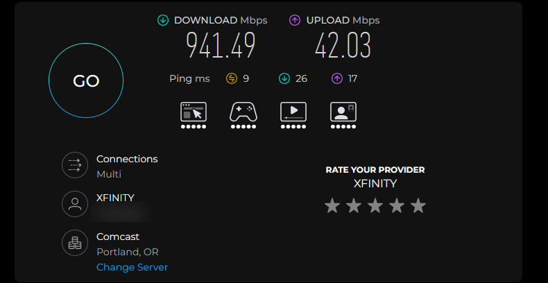

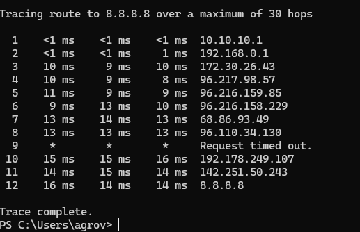

On FR2: 941 down / 42 up, with a 26 ms ping under load. The tracert confirms the path is PC → ISR (10.10.10.1) → TP-Link (192.168.0.1) → Comcast, so the ISR on the boost license routes full gigabit.

I am still troubleshooting FR1 and why the link went from 1000BASE-T to 100BASE-TX overnight. 1000BASE-T needs all four pairs working; 100BASE-TX only uses two (1-2 and 3-6). So my assumption is I need to redo my RJ45 Jacks and port panel. 
